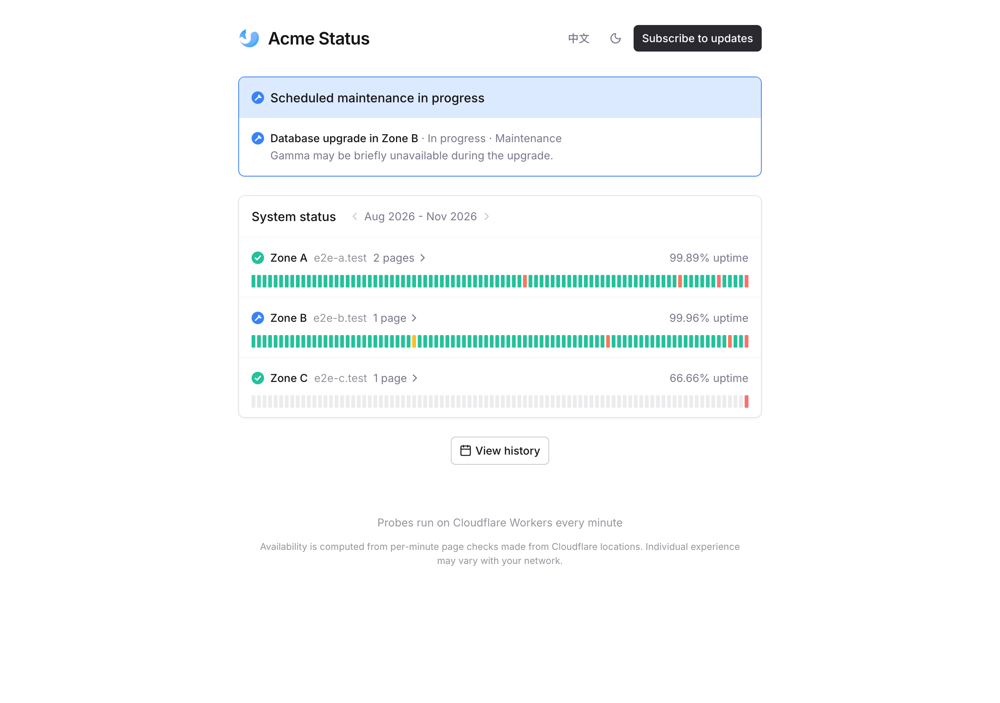
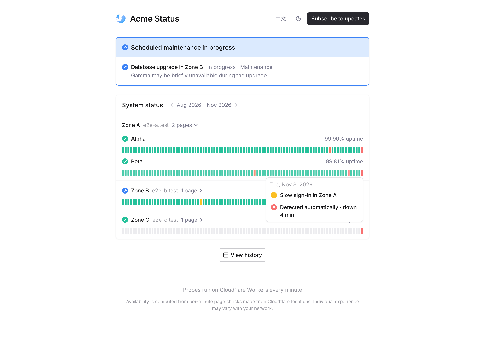
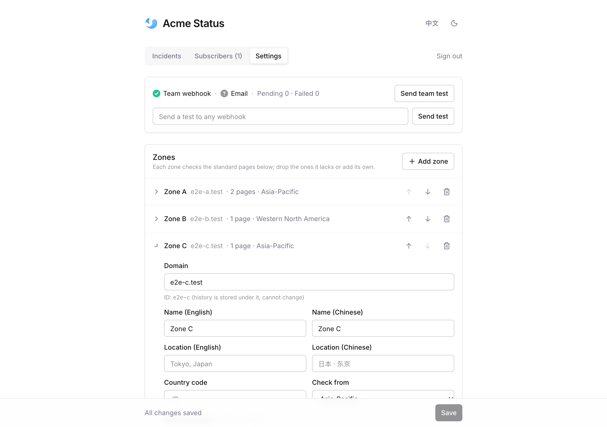

# Stratus

A status page for multi-region services that runs entirely on Cloudflare Workers. Every minute it
loads the pages of each zone from a Cloudflare location near that zone, keeps 90 days of
per-minute history, posts to your team's chat when something breaks, and lets visitors subscribe
to updates.



## Features

- **Per-zone monitoring.** Each zone is probed from a Durable Object placed in a region you pick
  (Western North America, Western Europe, Asia-Pacific, …), so every zone is checked from close
  to its users. A failed page is retried once after 2 seconds before it counts.
- **Status page.** Zones collapse into one row each with 90 days of history; expanding a zone
  shows its pages. Hover a day for what happened, click it for a minute-by-minute view. Incident
  history, incident pages, light and dark mode, mobile layout. The UI ships in English and
  Chinese.
- **Outage detection.** A page that keeps failing opens an outage. Once it has lasted longer than
  the grace period (3 minutes by default) it is announced, and so is the recovery. Short blips
  stay quiet.
- **Incidents and maintenance.** Publish incidents (investigating → identified → monitoring →
  resolved) and scheduled maintenance from the admin console, for whole zones or single pages.
  During a maintenance window, failed checks of the affected pages count as maintenance, not
  downtime.
- **Notifications.** Your team webhook receives every incident, maintenance and detected outage.
  Visitors can subscribe by email (via [Resend](https://resend.com)) or with a webhook, for all
  zones or selected ones. Slack, Discord, Feishu/Lark, DingTalk and WeCom bot URLs get a native
  message; any other URL receives JSON. Delivery goes through an outbox with retries.
- **Everything in the admin console.** Zones, pages, the team webhook, email, time zone and check
  parameters are edited in the browser and stored in D1. The only deploy-time setting is the admin
  password.

| Zone expanded | Admin settings |
| --- | --- |
|  |  |

## Deploy

You need a Cloudflare account on the Workers Paid plan (Durable Objects and a per-minute cron).

```bash
git clone https://github.com/sealos-tech/stratus.git
cd stratus
npm install
npx wrangler login
npx wrangler d1 create stratus
```

Copy the `database_id` that `d1 create` prints into `wrangler.jsonc`, then set the admin
password and deploy:

```bash
npx wrangler secret put ADMIN_TOKEN
npm run deploy
```

`ADMIN_TOKEN` must be at least 16 characters; a random one works well (`openssl rand -hex 16`).
`npm run deploy` builds the site, applies the D1 migrations and deploys the Worker with its cron
triggers. Then:

1. Open `https://<your-worker>.workers.dev/admin?p=<ADMIN_TOKEN>`. The token is moved out of the
   address bar into the tab's session as soon as the page loads.
2. Under **Settings**, set up your zones and pages, paste your team webhook, and set the site URL
   and time zone. Save; the next check round (within a minute) uses it.
3. Optionally add a custom domain to the Worker in the Cloudflare dashboard.

### Admin access

- The console only opens from its link (`/admin?p=…`); there is no login form to guess at.
- After **30 wrong tokens in a row from one IP**, that IP is refused for an hour, even with the
  right token. A correct token resets the count.
- To rotate the link, run `npx wrangler secret put ADMIN_TOKEN` again.

## Configuration

Everything below is edited in **Admin → Settings**. The defaults in
[`status.config.ts`](status.config.ts) apply until the first save; they ship with the zones of
[Sealos Cloud](https://sealos.io) as an example.

| Setting | What it does |
| --- | --- |
| Zones | Domain, display name and location, country, probe region, which standard pages the zone lacks, and pages only that zone has. **Check this zone now** tests a zone before you save it. |
| Standard pages | Pages every zone serves. `{domain}` in the URL is replaced with the zone's domain, e.g. `https://app.{domain}/login`. |
| Team webhook / signing secret | Receives every notification. The signing secret is only for Feishu/Lark bots with signature verification. Secrets are write-only: the console shows a masked hint and never sends them back. |
| Notify after (minutes) | How long a page must stay down before a detected outage is announced. `0` announces at once. |
| Resend API key / sender | With both set, visitors can subscribe by email. |
| Site title, URL, time zone, default language | The URL is used for links in notifications and emails. The time zone decides where a day starts in the history bars. The default language is used for team notifications and for visitors whose browser language is not supported. |
| Check timeout / slow threshold | A check fails after the timeout; a page slower than the threshold counts as slow. |

Display names are entered in English and, optionally, Chinese; an empty translation falls back to
the English name.

Environment variables, for completeness:

| Variable | Purpose |
| --- | --- |
| `ADMIN_TOKEN` | Secret. Password in the admin link. Unset or shorter than 16 characters disables the admin API. |
| `API_CACHE_SECONDS` | Edge cache lifetime of public API responses (default 30, `0` turns it off). |

## Develop

```bash
npm install
cp .dev.vars.example .dev.vars   # then set a 16+ character ADMIN_TOKEN
npm run db:migrate:local
npm run dev
```

Open <http://localhost:5173>, and the console at `http://localhost:5173/admin?p=<ADMIN_TOKEN>`.
The dev server runs a check round once a minute, as the cron does in production (`DEV_CRON=0`
turns that off). `npm run check` type-checks the app and the Worker.

## Tests

```bash
npx playwright install chromium
npm run test:e2e
```

The suite starts the real Worker in workerd against a throwaway D1 (`e2e/.state`), with test zones
whose pages are served by [`e2e/mock-server.mjs`](e2e/mock-server.mjs), which also records webhook
calls. It fires cron rounds with explicit timestamps and covers detection and the grace period,
team notifications for down and recovery, public webhook subscriptions filtered by zone,
publishing and resolving an incident, maintenance windows, configuring a zone in the admin
console, signed Feishu/Lark cards, the admin lockout, history, language switching, and the dark
and mobile layouts. Screenshots land in `e2e/screenshots/`.

## How it works

- **Worker** (`worker/`): `scheduled` runs a check round every minute and a cleanup once a day;
  `fetch` serves the JSON API and the static app. `Prober` is a Durable Object per zone, created
  with the zone's location hint.
- **App** (`src/`): Svelte 5 single-page app with Tailwind CSS, built with Vite and served as
  Worker static assets.
- **Data** (D1, see [`migrations/`](migrations)):
  - `daily`: one row per page per day, with per-minute status (`u` up, `d` slow, `x` down,
    `m` maintenance) and latency. Minute detail is kept 90 days, daily totals 400 days.
  - `kv`: the admin settings, and the latest result and daily totals of every page, so the home
    page is a single read.
  - `outages`: automatically detected failures. `events` and `event_updates`: published incidents
    and maintenance. `subscribers` and `outbox`: notification delivery. `auth_failures`: the admin
    lockout.

A check round costs one D1 batch (about one row per page) and one Durable Object call per zone,
well inside the Workers Paid plan's included usage.

## License

[MIT](LICENSE)
