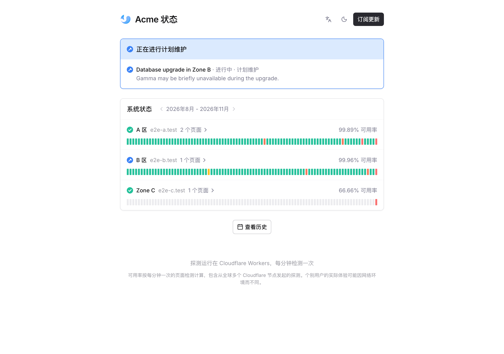
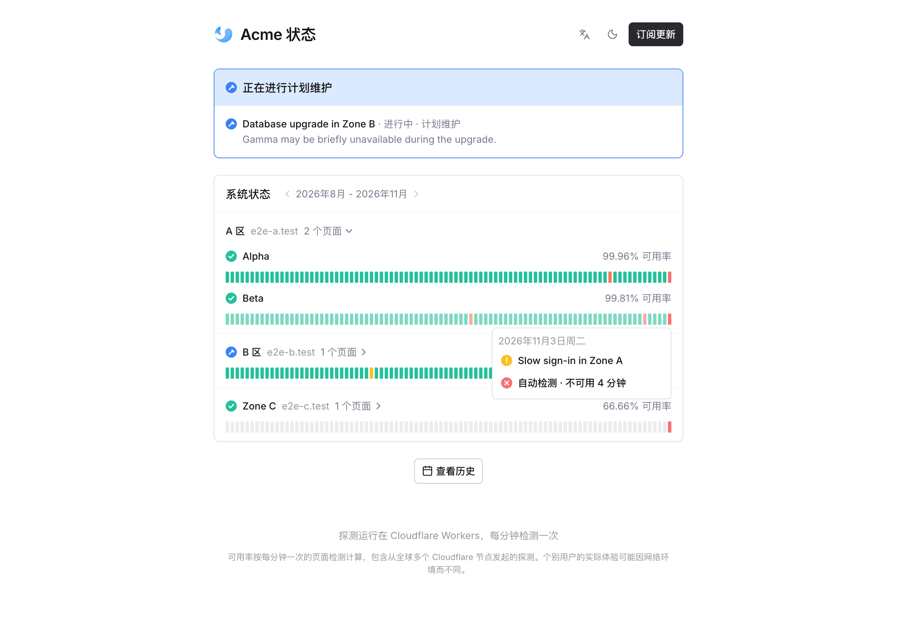
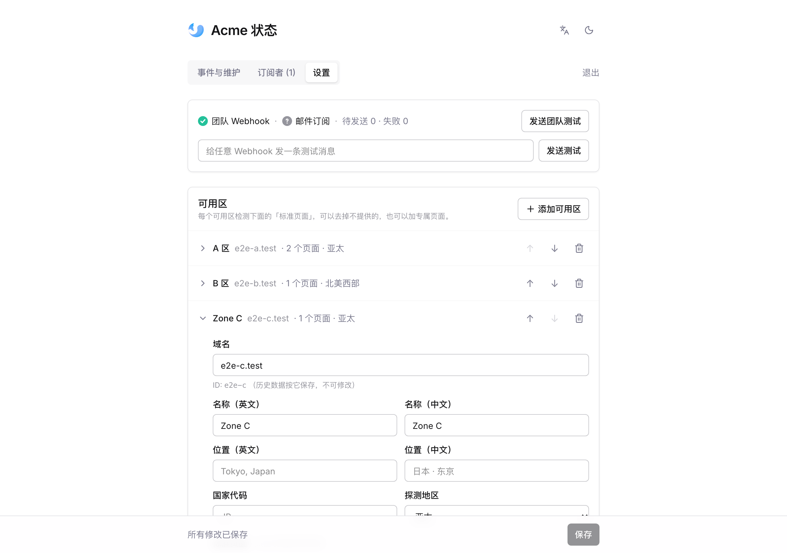

# Stratus

[English](README.md) | 简体中文

一个完全运行在 Cloudflare Workers 上的多区域服务状态页。它每分钟从离各个区域最近的 Cloudflare
节点访问一遍该区域的页面，保留 90 天的逐分钟历史；出现故障时发消息到团队群，访客也可以订阅更新。



## 功能

- **按区域探测**：每个区域由一个放在指定地区（北美西部、西欧、亚太等）的 Durable Object 负责检测，
  所以每个区域都从离它的用户最近的地方检测。页面失败后会在 2 秒后重试一次，仍然失败才记为故障。
- **状态页**：每个区域折叠成一行，显示 90 天历史；展开后可以看到它的每个页面。鼠标悬停在某一天上
  查看当天发生了什么，点击查看逐分钟详情。另有事件历史、事件详情页、浅色和深色模式、手机版布局。
  界面提供英文和中文。
- **故障检测**：页面持续失败会记为一次故障，持续时间超过宽限期（默认 3 分钟）后才发出通知，恢复时也会
  通知。短暂的抖动不会打扰人。
- **事件与维护**：在管理后台发布事件（调查中 → 已定位 → 观察中 → 已解决）和计划维护，可以针对整个
  区域或单个页面。维护期间，受影响页面的失败检测记为维护，不算故障。
- **通知**：团队 Webhook 会收到所有事件、维护和自动检测到的故障。访客可以用邮箱（通过
  [Resend](https://resend.com) 发送）或 Webhook 订阅全部或部分区域。Slack、Discord、飞书、钉钉和
  企业微信的机器人地址会收到对应平台格式的消息，其他地址收到 JSON。消息通过发件队列发送，失败会重试。
- **所有配置都在管理后台**：区域、页面、团队 Webhook、邮件、时区和检测参数都在浏览器里修改，保存在
  D1。部署时只需要设置一个后台密码。

| 展开区域 | 后台设置 |
| --- | --- |
|  |  |

## 部署

需要一个开通了 Workers 付费版的 Cloudflare 账号（会用到 Durable Objects 和每分钟一次的定时任务）。

```bash
git clone https://github.com/sealos-tech/stratus.git
cd stratus
npm install
npx wrangler login
npx wrangler d1 create stratus
```

把 `d1 create` 输出的 `database_id` 填进 `wrangler.jsonc`，然后设置后台密码并部署：

```bash
npx wrangler secret put ADMIN_TOKEN
npm run deploy
```

`ADMIN_TOKEN` 至少 16 个字符，建议使用随机字符串（`openssl rand -hex 16`）。`npm run deploy` 会构建
站点、执行 D1 迁移，并部署 Worker 及其定时任务。之后：

1. 打开 `https://<你的-worker>.workers.dev/admin?p=<ADMIN_TOKEN>`。页面加载后，令牌会从地址栏移到当前
   标签页的会话存储里。
2. 在「设置」里配置区域和页面，填入团队 Webhook，设置站点地址和时区，然后保存。下一轮检测（一分钟内）
   就会使用新配置。
3. 可以在 Cloudflare 控制台给 Worker 绑定自定义域名。

### 后台访问

- 后台只能通过它的链接（`/admin?p=…`）打开，没有可以反复猜测的登录表单。
- **同一个 IP 连续 30 次令牌错误**后，该 IP 会被拒绝一小时，即使之后使用了正确的令牌也不行。使用一次
  正确的令牌会清零计数。
- 要更换后台链接，重新执行 `npx wrangler secret put ADMIN_TOKEN`。

## 配置

以下所有项都在「后台 → 设置」里修改。第一次保存之前使用 [`status.config.ts`](status.config.ts) 里的
默认值，默认值以 [Sealos Cloud](https://sealos.io) 的各个区域作为示例。

| 设置项 | 作用 |
| --- | --- |
| 区域 | 域名、显示名称和位置、国家、探测地区、该区域没有的标准页面，以及只有该区域才有的页面。「立即检测这个区域」可以在保存前先测试一遍。 |
| 标准页面 | 每个区域都有的页面。地址里的 `{domain}` 会替换成区域的域名，例如 `https://app.{domain}/login`。 |
| 团队 Webhook / 签名密钥 | 接收所有通知。签名密钥只用于开启了签名校验的飞书机器人。密钥只写不读：后台只显示打码后的提示，不会把原值发回浏览器。 |
| 持续多少分钟才通知 | 自动检测到的故障要持续多久才发通知。`0` 表示立即通知。 |
| Resend API Key / 发件人 | 两项都设置后，访客才能用邮箱订阅。 |
| 站点标题、地址、时区、默认语言 | 地址用于通知和邮件里的链接。时区决定历史条中每一天从何时开始。默认语言用于团队通知，以及浏览器语言不受支持的访客。 |
| 检测超时 / 缓慢阈值 | 超时则检测失败；加载慢于阈值的页面记为「缓慢」。 |

显示名称先填英文，中文可选；没有填写的翻译会使用英文名称。

环境变量只有两个：

| 变量 | 作用 |
| --- | --- |
| `ADMIN_TOKEN` | 密钥，即后台链接里的密码。未设置或少于 16 个字符时，后台接口关闭。 |
| `API_CACHE_SECONDS` | 公开接口在边缘节点的缓存时长，单位秒（默认 30，`0` 表示不缓存）。 |

## 本地开发

```bash
npm install
cp .dev.vars.example .dev.vars   # 然后把 ADMIN_TOKEN 改成 16 位以上
npm run db:migrate:local
npm run dev
```

打开 <http://localhost:5173>，后台地址是 `http://localhost:5173/admin?p=<ADMIN_TOKEN>`。开发服务器会像
线上的定时任务一样每分钟检测一次（设置 `DEV_CRON=0` 可以关闭）。`npm run check` 对前端和 Worker 做类型
检查。

## 测试

```bash
npx playwright install chromium
npm run test:e2e
```

测试会在 workerd 中启动真实的 Worker，使用一次性的 D1（`e2e/.state`）。测试区域的页面由
[`e2e/mock-server.mjs`](e2e/mock-server.mjs) 提供，它同时记录收到的 Webhook 调用。测试用指定的时间戳
触发每一轮检测，覆盖故障检测与宽限期、故障和恢复的团队通知、按区域过滤的 Webhook 订阅、发布并解决事件、
维护窗口、在后台配置区域、带签名的飞书卡片、后台限流、事件历史、语言切换，以及深色模式和手机版布局。
截图保存在 `e2e/screenshots/`。

## 工作原理

- **Worker**（`worker/`）：`scheduled` 每分钟运行一轮检测，每天清理一次旧数据；`fetch` 提供 JSON 接口
  和静态页面。`Prober` 是每个区域一个的 Durable Object，按该区域的地区提示创建。
- **前端**（`src/`）：使用 Svelte 5 和 Tailwind CSS 的单页应用，用 Vite 构建，作为 Worker 的静态资源
  提供。
- **数据**（D1，见 [`migrations/`](migrations)）：
  - `daily`：每个页面每天一行，记录逐分钟状态（`u` 正常、`d` 缓慢、`x` 故障、`m` 维护）和响应时间。
    逐分钟明细保留 90 天，每日汇总保留 400 天。
  - `kv`：后台设置，以及每个页面的最新结果和每日汇总，首页只需读取一次。
  - `outages`：自动检测到的故障。`events` 和 `event_updates`：发布的事件和维护。`subscribers` 和
    `outbox`：通知发送。`auth_failures`：后台限流。

每轮检测的开销是一次 D1 批量写入（每个页面约一行）加上每个区域一次 Durable Object 调用，远在 Workers
付费版包含的用量之内。

## 许可证

[MIT](LICENSE)
